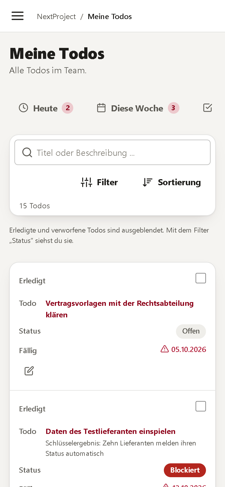
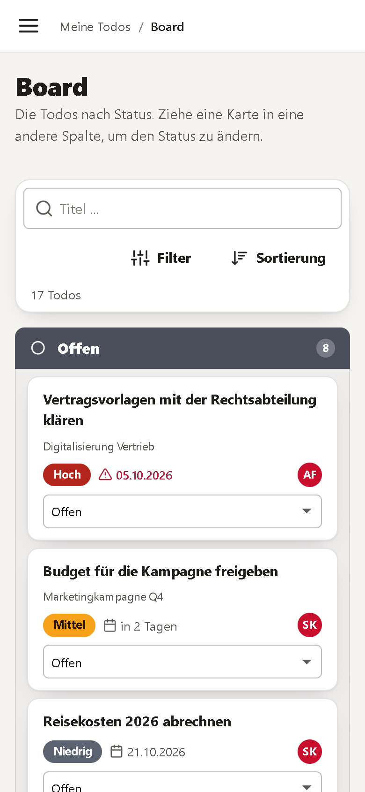

<div align="center">


# NextProject

**Goals, projects and todos in one place: who does what, by when, and does it get us where we want to go?**

Replaces the todo list and the spreadsheet for the progress of projects. Self-hosted, German interface, one container
plus a PostgreSQL, backups straight to your NAS.

</div>


---

## What this is about

The management of a company agrees on **goals**, starts **projects** to reach them and splits those into **todos**. In a spreadsheet the
connection between the three gets lost, and "80 % of the todos are done" is mistaken for "the goal is reached". NextProject keeps the
four levels apart and connected:

| Level | Question | In the software |
|---|---|---|
| **Goals** | What do we want to reach as a company? | Goal with yearly and quarterly targets, **key results** that measure it |
| **Projects** | Which initiatives pay into it? | Project with owner, team, milestones, risks, dependencies |
| **Todos** | Who does what by when? | Todo with one owner, status, checklist, comments, attachments, history |
| **Results** | How do we know it worked? | Measurements of the key results, reviews |

A todo may stand alone. Nothing has to belong to a project or a goal.

**Finished is not reached.** The share of finished todos is an *indicator* for a project; how far a goal is reached is told by its key
results, measured on a scale from a start value to a target. Both numbers are always shown side by side
([rules of progress](docs/PROGRESS.md)).

## At a glance

- **Todos**: create, assign, prioritise, move, finish or discard; one responsible person, optional contributors, start and due date,
  checklist, comments, attachments (files or links), dependencies, the result written down. *Overdue* is worked out from the due date and
  the status, never set by hand. A **block** needs a reason and says what help or decision is needed. Every change of status, owner and
  due date stays in the **history**
- **Lists that find things**: search, filters (status, owner, priority, project, due date) and sort above every list; tabs *Today*,
  *This week*, *All mine*, *Team*; a **board** (drag a card to another column; every card also has a select for phones and keyboards)
- **Projects & goals as cards** (a switch to the list): a coloured tile for the state, the two numbers side by side, what needs a look
- **Projects**: owner, team, period, status (planning, in progress, **at risk**, paused, completed, cancelled), priority, budget, effort,
  milestones, risks, dependencies, goals and key results; tabs for the todo list, the board and a **schedule**. The software points out
  what looks bad (blocked todos, overdue ones, a late milestone, a high risk, an end date that has passed, a pace behind time)
- **Goals & OKRs**: goals with yearly and quarterly targets, key results with start value, target, unit, how it is measured and
  **check-ins** (value, and the share of the linked todos that were done at that time, as in the planning sheet)
- **Reviews**: the four questions of the review sheet (deviation of implementation from strategy, learnings, adjustments, steering)
- **Dashboard, team, reports**: what is mine today, where the team is stuck, the table "strategic implementation" and CSV exports for the spreadsheet
- **Calendar**: three views. *Monat* shows every due date, milestone, project end, key-result date and review, with **filters** (whose, project,
  person, department, goal, kind, status, search) and a legend; click a todo to move or finish it, **drag it to another day** to change its due date
  (the start moves along), click a day to create a todo there. *Zeitplan* is a **Gantt view**: the projects below each other, the time from left
  to right (3, 6 or 12 months), the share of finished todos inside each bar, milestones on it, the todos of a project one click away.
  *Auslastung* counts the open todos per person and week. Every user has a private **iCal subscription** (a secret address that can be
  replaced) and can download the file
- **Roles**: *Admin*, *User* and *Anonymous*, which is a **share link** to a project or a goal (read only, expiry, optional password,
  counted views, can be revoked)
- **Sign-in**: local accounts, **TOTP** (authenticator app) with recovery codes, lock-out after wrong passwords, sessions kept in the
  database (a restart keeps everybody signed in)
- **Backup**: plans with a **schedule** (hourly, daily, weekly, monthly) to a folder or **directly to a NAS over SMB**, with
  **retention** (last N, daily, weekly, monthly), optional encryption, a restore with a safety copy and a check before anything changes
- **Mobile**, light, dark and system theme, no scrollbars until something scrolls


<table>
<tr>
<td width="50%"></td>
<td width="50%"></td>
</tr>
<tr>
<td></td>
<td></td>
</tr>
<tr>
<td></td>
<td></td>
</tr>
</table>

<table>
<tr>
<td width="25%"></td>
<td width="25%"></td>
<td width="25%"></td>
<td width="25%"></td>
</tr>
</table>

## Run it

```yaml
# docker-compose.yml: one app, one database, two volumes
services:
  nextproject:
    image: ghcr.io/real-ttx/nextproject:latest
    ports: ["2860:2860"]
    volumes: [nextproject-data:/data]
    depends_on: [db]
  db:
    image: postgres:17
    environment: { POSTGRES_PASSWORD: nextproject }
    volumes: [nextproject-db:/var/lib/postgresql/data]
volumes: { nextproject-data: , nextproject-db: }
```

Open <http://localhost:2860>: the first visit asks for the first administrator. Put a reverse proxy with TLS in front for real use
(then set the public address and "secure cookie" under *Einstellungen › Sicherheit*). Under *Einstellungen › System* an empty
installation can be filled with **sample data** to try it out.

What lives in the volume `/data`: `config/app.json` (the settings), `keys/` (protect the cookies and the saved passwords: **keep it
in every backup**), `files/` (attachments, unless a NAS is chosen), `backups/` and `tmp/`. More in [docs/OPERATIONS.md](docs/OPERATIONS.md).

## Develop

```powershell
./scripts/redeploy.ps1          # rebuild the image and redeploy the dev stack: web 2860, pgAdmin 2861, Postgres 12860
./scripts/redeploy.ps1 -Fresh   # the same with empty volumes (setup page again)
dotnet build NextProject.slnx
dotnet test NextProject.slnx    # integration tests need NEXTPROJECT_TEST_DB (and NEXTPROJECT_TEST_SMB), see CLAUDE.md
```

Stack: ASP.NET Core 10 Razor Pages, EF Core on PostgreSQL 17, the MatDesign toolkit ([MatUi](src/NextProject/wwwroot/ui)) for the
interface (only the basics: shell, forms, tables, dialogs, the schedule) plus our own bold components in `np-ui.css`
([what MatDesign lacks](docs/DESIGN-GAPS.md)), plain CSS and JavaScript without a build step. Branches: `main` (release), `dev` (development); the GitHub action builds
and publishes the image: `<major>.<minor>.<build>-<date>` for releases, `nightly-<build>-<date>` for `dev`.

More: [features and rules of progress](docs/PROGRESS.md) · [operation](docs/OPERATIONS.md) · [notes for working in the repository](CLAUDE.md)
